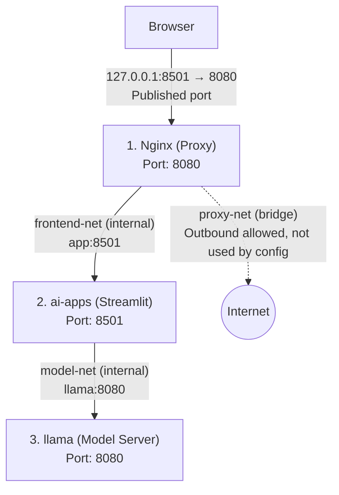

# Run the production container

## Build the production image

```powershell
docker build --pull --no-cache -f Dockerfile.prod -t ai-apps-prod-image .
```

## Interactive Run

For the CUDA image (powershell):

```powershell
docker run `
    --name ai-apps-prod-container `
    --gpus all `
    --cap-drop=ALL `
    --security-opt=no-new-privileges `
    -p 127.0.0.1:8501:8501 `
    ai-apps-prod-image
```

For the CPU-only image, remove:

```text
--gpus all
```

The Dockerfile `CMD` starts Streamlit automatically. Do not add `bash` to this production command. If you add `bash`, it replaces the Dockerfile `CMD`.

`--gpus all` gives the container access to the available NVIDIA GPUs. Docker requires the GPU to be explicitly made available to the container (https://docs.docker.com/reference/cli/docker/container/run). Docker also supports removing Linux capabilities with `--cap-drop`; `ALL` removes all of them.

* `run` → creates and starts a container from the image.
* `--name ai-apps-prod-container` → gives the container a readable name.
* `--gpus all` → gives the container access to all available NVIDIA GPUs.
* `--cap-drop=ALL` → removes all Linux capabilities from processes in the container. This will prevent the container from performing administrative operations that are normally allowed for root.
* `Linux capability` → a specific administrative permission that Linux can give to a process.
* `--security-opt=no-new-privileges` → prevents a process from gaining additional privileges when it starts another program.
* `privilege` → permission to perform an operation that a normal user cannot perform.
* `-p 127.0.0.1:8501:8501` → publishes Streamlit only on the local host, as explained earlier. Docker warns that omitting the host address can publish the port on all host network interfaces.
* `ai-apps-prod-image` → the image that you built.
* There is no `bash` at the end → Docker uses the Dockerfile `CMD` and starts Streamlit.

> After the first final build, test one Kaleido image export with these security options. Do **not** solve a Chrome problem by adding `--no-sandbox`; Chromium states that this disables important browser security protections. 

For more advanced container health monitoring, consider adding a `HEALTHCHECK` instruction in your Dockerfile.

- Healthcheck: https://docs.docker.com/reference/dockerfile/#healthcheck


## Run via Docker Compose



> **Note:** Port numbers repeat (8501, 8080), but they are different ports. Each container has its own network namespace, so its ports are separate. Only `127.0.0.1:8501` is on the host.

### nginx-unprivileged-image

- A container with no internet (`internal: true`) cannot publish a port to the host.
- So if the app must have no internet and still be reachable from the browser, you need a proxy (nginx) between them.

| | app | nginx |
|---|---|---|
| Code | your code + dozens of Python packages | nginx only, known and scanned |
| Supply chain risk | high, any package can be malicious | very low |
| What it can do | anything the code does | only what the config says: forward to `app:8501` |
| Internet | **no** | **yes** |

If a Python package is malicious and tries to send your data out, it cannot, because the app has no route to the internet. nginx cannot help it either, because its config forwards nothing outward.

In short: the risk is not zero, but it moves from a large, unknown component to a small, known one.

> So, first pull the `nginx-unprivileged` image:

```powershell
docker pull nginxinc/nginx-unprivileged:stable-alpine-slim
```

### Compose the container

Instead of running the container with `docker run`, you can use `docker compose` to manage the container. You will find the `docker-compose-prod.yaml` file in the `production` directory.

```powershell
docker compose -f docker-compose-prod.yaml up -d
```

- `docker compose` — Manages multiple containers.
- `-f` — Specifies the Compose YAML file.
- `up` — Creates and starts the containers.
- `-d` — Runs containers in the background (detached).

### View the application

The application should now be running in the Docker container.

Open http://localhost:8501 on your web browser.

### Stop the container

```
docker compose -f docker-compose-prod.yaml stop
```

Stops containers without removing them.

### Restart the container

```
docker compose -f docker-compose-prod.yaml restart
```

Restarts existing containers without recreating them.

### Stop and remove the container

```
docker compose -f docker-compose-prod.yaml down
```

Stops and removes the container and project networks. Named volumes remain intact by default.

